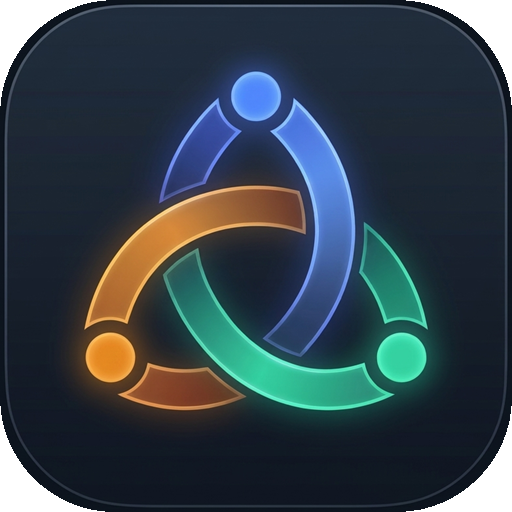

<p align="center">
  
</p>

<h1 align="center">CollabStudio</h1>

<p align="center"><a href="README.md">简体中文</a> · English</p>

CollabStudio is a desktop workbench for developing software with Antigravity (Gemini), Claude and Codex. Organize projects, discuss requirements, route work to the right CLI at each stage, and keep handoffs in the repository.

| Agent | Typical work | Project rules |
| --- | --- | --- |
| Antigravity (Gemini) | Planning, a second design proposal, UX and copy review | `GEMINI.md` |
| Claude | Frontend visuals and motion, proposal merging and independent review | `CLAUDE.md` |
| Codex | Backend design, implementation and tiered engineering review | `AGENTS.md` |

## What you can do

- **Manage projects and subprojects.** Filter the workspace tree, compare progress and switch between siblings. Add a subproject manually or scan up to two directory levels and import selected folders. Subprojects keep their own state, docs, discussions and model routing, and inherit the main project’s agent rules by default.
- **Discuss a plan before implementation.** Add requirements and drop reference files into the discussion or use the desktop file picker. Text attachments contribute their contents and binary attachments contribute a local path. Switch agents, models or reasoning effort while keeping the same thread. Finalizing a plan writes it to `docs/01-brief.md`, completes the first gate and can advance the project stage.
- **Run local CLIs.** CollabStudio detects Codex, Claude and Antigravity (`agy`) and supports a custom executable path and extra arguments. Inline runs pass prompts on standard input and show live output, activity, elapsed time and the PID. You can stop a run and revisit its output during the current session. Interactive runs open Terminal on macOS or Windows Terminal with a PowerShell fallback on Windows. The CLI configuration is stored in CollabStudio’s own data directory.
- **Choose a model for each stage.** Set separate CLI, model and reasoning defaults for the five stages. Choose a model from the catalog or enter its name. Override the defaults for a single run, and choose default, auto-edit or skip-confirmation permissions.
- **Hand off by file.** Draft major proposals independently, verify them before merging, and review the result against the frontend spec and API contract. Record release blockers and suggestions separately, with up to two review rounds. Turn recurring defects into type checks or regression tests.

| CLI | Model | Reasoning effort | Auto-edit / skip confirmation |
| --- | --- | --- | --- |
| Codex | `-m <model>` | `-c model_reasoning_effort="<effort>"` | `--full-auto` / `--dangerously-bypass-approvals-and-sandbox` |
| Claude | `--model <model>` | `--effort <effort>` | `--permission-mode acceptEdits` / `--dangerously-skip-permissions` |
| Antigravity | `--model <model>` | `--effort <effort>` | `--mode accept-edits` / `--dangerously-skip-permissions` |

## Project files

CollabStudio can scaffold the following files when you add a project. Existing files are preserved.

```text
<your-workspace>/
├── AGENTS.md
├── CLAUDE.md
├── GEMINI.md
├── .collab-state.json          # Stage, gates, model routing and subprojects
├── .collab-discussion.json     # Created as discussion messages or attachments are added
├── prototypes/
├── docs/
│   ├── 01-brief.md
│   ├── 02-frontend-spec.md
│   ├── 03-api-contract.md
│   ├── 03b-backend-design.md
│   ├── 04-tasks.md             # Source for milestone progress
│   └── 05-review-log.md
└── apps/web/                   # Example subproject with its own state and docs
```

## Quick start

### macOS desktop app

Get the ZIP for your Mac from [GitHub Releases](https://github.com/FriedOnion2/CollabStudio/releases). Choose `macos-arm64` for Apple silicon or `macos-x64` for Intel. Unzip it, drag `CollabStudio.app` to Applications and open it. The desktop bundle includes Electron. Install and sign in to the agent CLIs you intend to use.

Local builds use an ad hoc signature. If macOS blocks a downloaded build, verify its source and SHA-256, then look for **Open Anyway** under **System Settings → Privacy & Security**. Developer ID signing and notarization are separate distribution steps.

Choose **简体中文** or **English** in the sidebar. CollabStudio remembers the selection and uses it for the interface, built-in prompts and new project templates. Simplified Chinese is the default. Existing project files, discussion content and raw CLI output keep their original language.

### Develop and build

Install Node.js 18 or newer, then run:

```sh
git clone https://github.com/FriedOnion2/CollabStudio.git
cd CollabStudio
npm ci
npm start
```

On macOS:

```sh
npm run build:mac           # current architecture
npm run build:mac -- arm64  # Apple silicon
npm run build:mac -- x64    # Intel
```

The build writes `dist/CollabStudio-v1.2.1-macos-<arch>.zip`. Unzip it to get `CollabStudio.app`. The desktop app checks the macOS login shell’s PATH and common install directories. Enter an absolute executable path in CLI settings to override detection.

For Windows x64:

```powershell
npm run build:win
```

The executable is `dist/CollabStudio-win32-x64/CollabStudio.exe`. Use `npm.cmd` if PowerShell blocks `npm.ps1`.

### Browser mode

```sh
npm run dev:web
```

Open `http://127.0.0.1:43980`. Set `PORT` to change the port. Browser mode uses Node.js built-ins and supports manual project paths and drag-and-drop attachments. Use the desktop app for macOS native file and folder pickers.

## Source layout

| Path | Purpose |
| --- | --- |
| `electron/` | Desktop startup, native menus and dialogs, and IPC |
| `lib/store.mjs`, `lib/scaffold.mjs` | Project registration, state, task parsing and project scaffolding |
| `lib/prompts.mjs`, `lib/workflow-messages.mjs` | Stage handoff prompts and localized templates |
| `lib/cli.mjs`, `lib/macos-terminal.mjs` | CLI discovery, argument building, inline streaming and Terminal launch |
| `lib/discussion.mjs` | Discussion history, attachment context and plan finalization |
| `public/` | Workspace, discussion, document editor and CLI output |
| `server.mjs` | Local HTTP API and live event stream |
| `skill/SKILL.md` | Companion Antigravity skill |

## License

MIT
