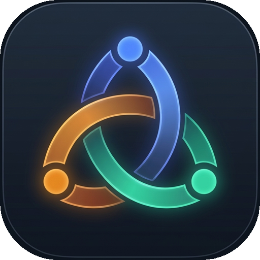

<p align="center">
  
</p>

<h1 align="center">CollabStudio</h1>

<p align="center">
  <strong>Antigravity (Gemini) × Claude × Codex (GPT) 三端 AI 协同开发桌面控制台</strong><br/>
  文件驱动交接（SSOT）· 5 阶段门禁管线 · 一键双/三端交接口令 · 独立 Windows 桌面客户端
</p>

---

## 核心理念：把多模型协作做成管理学

没有单一模型在所有维度都是完美答案，**CollabStudio** 把三家顶级模型放到各自最擅长的工位上，用仓库内的规则文件与标准文档彻底消除口头传话和上下文漂移：

| 模型 / 工具 | 最佳工位 | 核心强项 | 规则文件定向约束 |
| :--- | :--- | :--- | :--- |
| **Antigravity (Gemini)** | 军师 · 总体规划 · 文案/UX顾问 | 可沟通性第一、创意发散、产品文案去机械味 | `GEMINI.md`：未核实事实须标「推测」，验收只开结构化返工单 |
| **Claude** | 高审美前端/动效 · 编排主控 · 独立复审 | 前端视觉/动效王中王、工具编排、双方案合并 | `CLAUDE.md`：强约束「改全与核实」，列全同类一次改齐并实测 |
| **Codex (GPT)** | 硬核后端 · 切片编码 · 分级代码审查 | 后端/算法/修 Bug 极其严谨 | `AGENTS.md`：两级审查（Blocker vs Suggestion）+ 最多 2 轮防死循环 |

### 内置最佳实践（融合实战多模型协同方法论）
- **独立双方案合并（Blind Draft）**：大规划时让 Gemini 与 Claude 各自只看原始需求独立出方案，核实后再合并，避免锚定偏差。
- **界面文案与交互润色**：初版 UI 完成后一键发给 Gemini 去掉 AI 机械解释文案，改成说人话的产品表达。
- **两级分级审查（≤ 2 轮防死循环）**：只有会导致算错钱、丢数据、越权、发错消息或发布事故且有明确复现路径的问题才算 Blocker 挡上线；其余作为 Suggestion 记录。
- **错一次 → 硬检查（Mistake → Guardrail）**：每次人类纠正或审查退回，优先转成类型检查或守卫测试永久拦截同类错误。
- **统一「先问清单」**：删数据、停服、花钱、对外发消息、改方向、换密钥、改权限必须先问人类，其余自主推进。

---

## 仓库交接骨架（SSOT）

在 CollabStudio 中点击「新建 / 导入项目」，一键生成零覆盖的标准目录：

```text
<your-project>/
├── AGENTS.md                 # Codex (GPT) 行为铁律与两级审查规范
├── CLAUDE.md                 # Claude 改全与核实铁律
├── GEMINI.md                 # Antigravity (Gemini) 防幻觉与文案顾问铁律
├── .collab-state.json        # 阶段、门禁与契约冻结状态
├── prototypes/               # 可选：静态高保真视觉原型
└── docs/
    ├── 01-brief.md           # 总体架构、V1 非目标与双方案合并记录
    ├── 02-frontend-spec.md   # Design Tokens、页面状态矩阵与文案润色
    ├── 03-api-contract.md    # 前后端接口契约（冻结后三端严格遵守）
    ├── 03b-backend-design.md # 后端详细设计、Schema 与异常处理
    ├── 04-tasks.md           # 垂直切片 Milestone 清单（CollabStudio 实时解析进度）
    └── 05-review-log.md      # 分级审查记录、设计验收单与硬检查欠账表
```

---

## 快速开始

### 1. 开发运行（Electron 独立窗口）
```bash
npm install
npm start
```

### 2. 打包 Windows 独立客户端（`CollabStudio.exe`）
```bash
npm run build:win
# 产物位于 dist/CollabStudio-win32-x64/CollabStudio.exe
```

> 如需在纯浏览器模式下启动本地服务（不依赖 Electron），可执行 `npm run dev:web`。

---

## License

MIT
